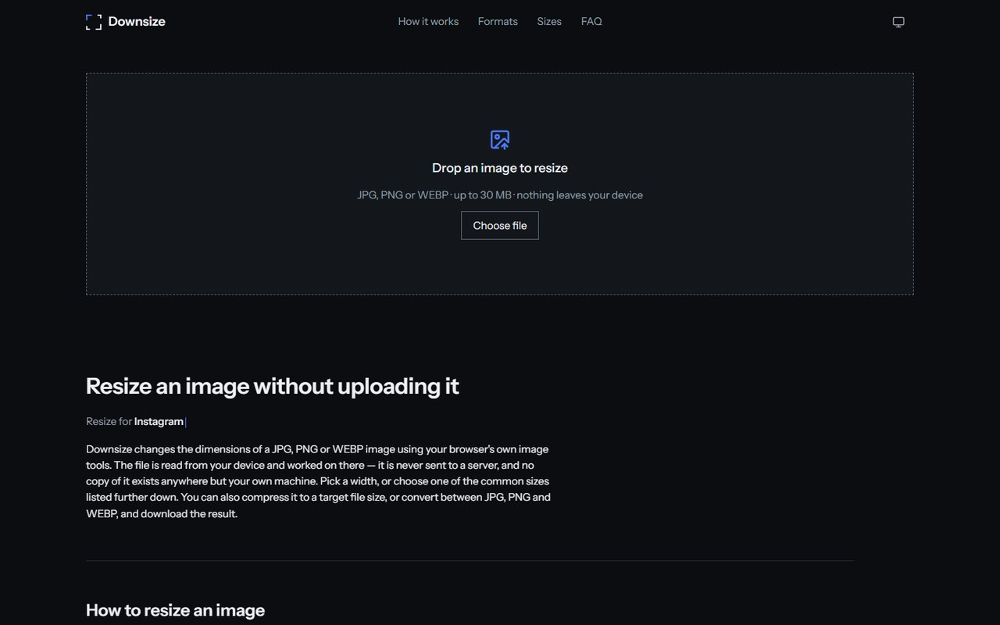

# Downsize

**Resize, compress and convert images entirely in your browser. Nothing is uploaded.**

🔗 **Live:** https://downsize-alpha.vercel.app



Downsize is a single-page image tool for people who need a correctly sized image right now: social media managers, bloggers, store owners, students uploading a form photo. All processing happens locally with the Canvas API, so there is no backend, no queue, no storage and no account.

## Features

- Drag-and-drop or file-picker upload, with validation of file type, size and whether the image can be decoded
- Preview with real metadata: dimensions, file size and format
- **Resize** by width, height, percentage or preset, with aspect-ratio lock (on by default)
- **Compress** with a quality control or a target file size
- **Convert** between image formats
- Before/after comparison of dimensions and file size
- Download with a sensible filename
- Light and dark theme

## Tech stack

| | |
|---|---|
| Framework | React 19 · TypeScript |
| Build | Vite 8 |
| Styling | Tailwind CSS v4 |
| Icons | lucide-react |
| Linting | oxlint |

## Run locally

Requires Node.js 20 or newer.

```bash
npm install
npm run dev       # http://localhost:5173
```

| Script | What it does |
|---|---|
| `npm run dev` | Start the Vite dev server |
| `npm run build` | Type-check (`tsc -b`) and build for production |
| `npm run preview` | Serve the production build |
| `npm run lint` | Lint with oxlint |

## Project structure

```
src/
  components/
    upload/      Dropzone and file errors
    workspace/   Resize, compress and convert controls, canvas, presets, download bar
    layout/      Navbar, logo, theme toggle
    ui/          Button, number field, toggle, spinner
  hooks/         useImageFile, useImagePipeline, useTheme
  lib/           Constants
```

The full product specification is in [`downsize-spec.md`](downsize-spec.md).

## Privacy

Images never leave the device. There are no network requests for image data, no analytics on file contents and no server.
